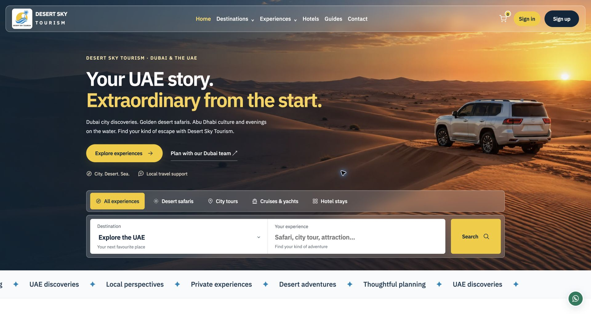

# Desert Sky Tourism

Website design and development by **Muhammad Ali — Ali Dev Solutions**.

[Visit website](https://desertskytourism.com) · [Developer portfolio](https://alidevsolutions.com)



## Project overview

This repository showcases the custom PHP/SQLite implementation prepared for Desert Sky Tourism. It includes the available local application source, styles, scripts and website assets. It is a source snapshot, not a synchronized export of the live CMS. Later content edits on the live server may differ.

## Features

- Tour and destination catalog, guides and responsive search/filter interfaces.
- Custom CMS, review management, galleries and administrator roles.
- Customer accounts, cart and booking history.
- Stripe payment integration and SMTP email configuration interfaces.
- Google tracking controls, SEO metadata and sitemap.

## Technology

PHP 8.2+, SQLite through PDO, HTML, CSS and JavaScript. Apache/LiteSpeed rewrite rules are included. PHP extensions include PDO SQLite, mbstring, DOM, fileinfo, GD/WebP, OpenSSL and cURL as used by each feature. Bundled third-party libraries retain their own license files.

## Setup

After cloning, extract every `resources/assets-*.zip` archive into the repository root. These archives contain the original media and larger public template/seed files, with their folder paths preserved. Application code remains browsable in the repository.

```sh
for archive in resources/assets-*.zip; do unzip -n "$archive"; done
```

See [SETUP.md](SETUP.md) for folder layout and configuration. Production databases, account credentials, mail settings, payment keys, customer records and uploaded runtime files are intentionally excluded. Configure your own origin, private data location and administrator account before use.

GitHub hosts the source; the PHP application needs a PHP-capable server and does not run on GitHub Pages. This upload does not redeploy the live website.

## Author

**Muhammad Ali** — [Ali Dev Solutions](https://alidevsolutions.com)

## Rights

Published as a portfolio and source reference. No general open-source license is granted for original project code or branded content. Third-party libraries, fonts, images and client materials remain subject to their respective rights and licenses.
